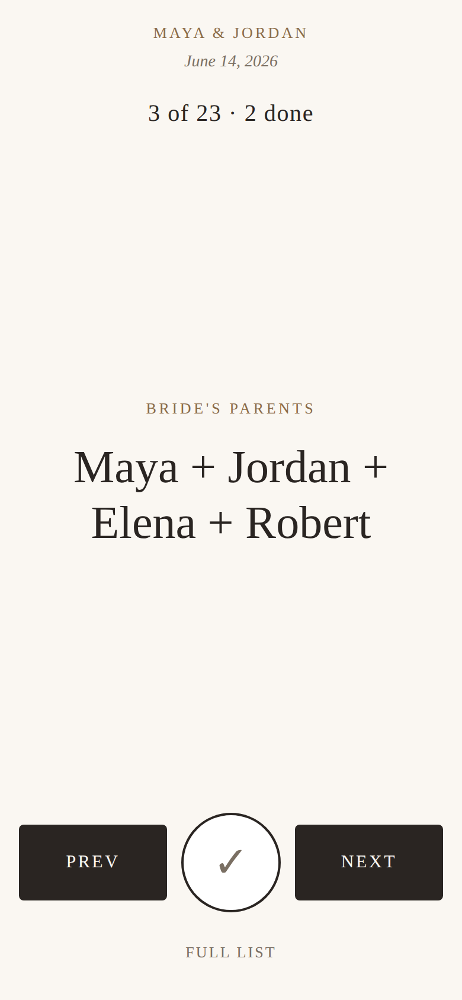

# Formals — Wedding Photo Shot List

Per-event tool for the must-have formal group photos at a wedding. Families fill in first names. The photographer gets a numbered call-out list, and a big-type day-of view for the assistant.

Live site: https://formals.vercel.app

## Files

- `config.js` — the only place the Supabase URL and public anon key live
- `admin.html` — dashboard. Sign-in is a Supabase magic link for an allowlisted email
- `wedding-shot-list.html` — couple and family page, opened with `?e=slug`. Add `&view=dayof` for the call-out screen
- `SETUP.md` — Supabase setup, including the SQL that locks the database down

## What changed

The first version let anyone with the public anon key read, edit, and delete every event, and the admin page was a passphrase written in the source. This pass closes that and makes the wedding day easier to run.

- **Database access is scoped to one slug.** Family pages call `get_event`, `save_event`, and `save_progress`. The anon key has no select, insert, update, or delete on the table. Creating, listing, renaming, locking, and deleting events requires a signed-in email on `admin_allowlist`.
- **Day-of mode.** One group on screen, large type, previous and next, a done check, and a counter (`3 of 23 · 2 done`). Built for a phone. Arrow keys work on a laptop. Swipe works on a phone.
- **Lock.** The admin can lock a list so the family can view it but not keep editing. The page shows when the names were last edited. Day-of checkmarks still save after a lock.
- **One config file.** Both pages read `config.js`. The anon key there is the public client key. Do not put the service role key or the database password in this repo.

Shipping the HTML does not change the live database. Run the SQL in [SETUP.md](SETUP.md) or the old open policies stay in force. Until that SQL is applied, the new family page will say setup is needed instead of loading a list.

## Still rough

- The slug in the link is still the family's credential. Anyone with the link can edit until the list is locked, and can mark groups done after that.
- There is no rate limit on the public functions.
- Day-of checkmarks are one shared set per event. Two assistants tapping different groups at the same moment can overwrite each other.
- Two people editing names at once: the last save wins for the whole name list. Name saves and checkmarks no longer wipe each other.
- Magic-link mail uses Supabase's built-in sender unless custom SMTP is added. The free tier is easy to rate-limit, and the link has to be opened in the same browser that asked for it.
- Live updates depend on the realtime trigger in SETUP.md. If that trigger fails, edits still save; the other phone just does not update on its own.

## Deploy

Static files. No build. Vercel, Netlify, or any host that serves HTML.

- Admin: `https://formals.vercel.app/admin.html`
- Family list: `https://formals.vercel.app/wedding-shot-list.html?e=SLUG`
- Day-of: `https://formals.vercel.app/wedding-shot-list.html?e=SLUG&view=dayof`
